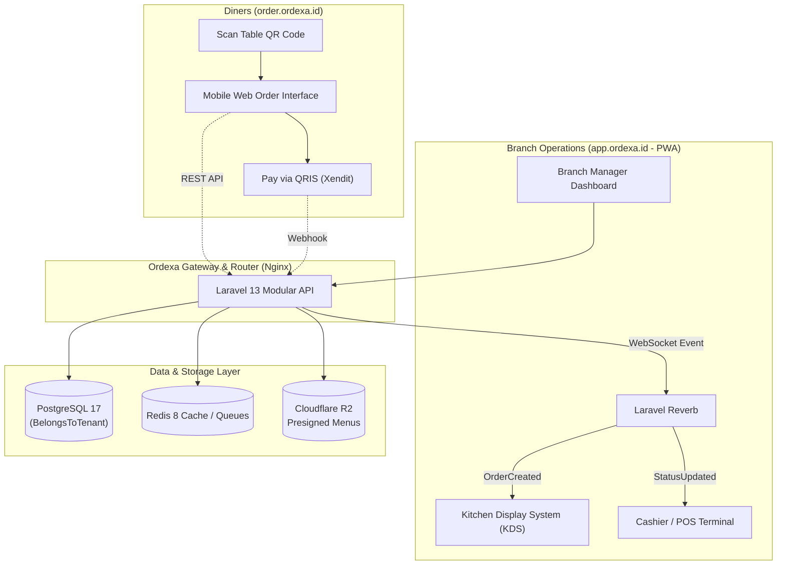

# Ordexa

> **National Restaurant Ordering & Multi-Tenant Management Ecosystem**  
> Scalable B2B2C SaaS platform connecting culinary businesses, staff, and diners across Indonesia.

[](https://nextjs.org)
[](https://laravel.com)
[](https://www.postgresql.org)
[](https://laravel.com/docs/reverb)
[](LICENSE)

---

## 1. Overview

**Ordexa** is an end-to-end multi-tenant SaaS ecosystem purpose-built for the Indonesian food and beverage industry (UMKM to multi-branch restaurant chains). It unifies self-service customer ordering, live kitchen operations, POS cashier stations, multi-branch administration, and subscription management into a single modular architecture.

### The Problem It Solves
- **Fragmented Operations**: Eliminates the mismatch between separate cashier apps, manual paper kitchen tickets, and third-party aggregator tablets.
- **Zero-Friction Customer Ordering**: Diners scan a table QR code and order immediately on mobile web—no app download, no account registration required.
- **Fair Multi-Branch Scaling**: Every subscription tier includes **unlimited branch locations**, shifting billing logic from branch limits to business features.
- **Strict Financial Separation**: Dual-track payment processing prevents platform liability and co-mingling of funds by routing customer order revenue directly to restaurant sub-merchant merchant accounts.

---

## 2. Core Architecture & Request Flow

Ordexa uses a **Modular Monolith** architecture backend with a **Next.js 16 App Router** frontend, coordinated through WebSockets and PostgreSQL multi-tenant row-level scoping.



### Architectural Guardrails

1. **Shared Database, Isolated Tenancy**: Single PostgreSQL database with strict `tenant_id` scoping enforced via Eloquent global scopes (`BelongsToTenant`) and Sanctum authorization policies.
2. **Dual-Track Payment Separation**:
   - **Track 1 (Platform Subscriptions)**: SaaS fees paid directly to Ordexa's master gateway account (Midtrans / Xendit).
   - **Track 2 (Customer Orders)**: Diners pay directly into the restaurant's merchant sub-account via Xendit xenPlatform. Platform funds and merchant order revenues never mix.
3. **PWA + Web Split**:
   - Customer QR ordering is a lightning-fast, zero-login mobile web application.
   - Operations dashboards (Admin, Manager, Cashier, Kitchen) are installable Progressive Web Apps (PWA) with offline-tolerant static assets and sound-enabled order dispatching.
4. **Guaranteed Financial Consistency**: All multi-step order updates and payment status transitions are wrapped in atomic database transactions with webhook idempotency keys.

---

## 3. Monorepo Structure

The repository is organized as a unified monorepo powered by `pnpm` workspaces for frontend packages and Composer for the backend:

```text
ordexa/
├── apps/
│   ├── api/                     # Laravel 13 Modular Monolith API
│   │   ├── app/
│   │   │   ├── Http/            # Base controllers, middleware, requests
│   │   │   ├── Models/          # Core models (User, Membership, BaseTenant)
│   │   │   └── Modules/         # Domain Modules
│   │   │       ├── Auth/        # Sanctum authentication & RBAC
│   │   │       ├── Tenant/      # Restaurant entity & tenancy scopes
│   │   │       ├── Subscription/# Packages, entitlement & billing
│   │   │       ├── Branch/      # Unlimited branch management
│   │   │       ├── Table/       # Tables & dynamic QR token generator
│   │   │       ├── Menu/        # Categories, items, modifiers, R2 media
│   │   │       ├── Order/       # Order state machine & item tracking
│   │   │       ├── Payment/     # PaymentGatewayInterface & Xendit adapter
│   │   │       └── Partner/     # Affiliate & sales referral engine
│   │   ├── database/            # PostgreSQL migrations, seeders, factories
│   │   └── routes/              # api.php, webhooks.php, channels.php
│   │
│   └── web/                     # Next.js 16 (React 19, TypeScript, Tailwind CSS)
│       ├── app/
│       │   ├── (auth)/          # Authentication & verification
│       │   ├── super-admin/     # Platform SaaS control center (PWA)
│       │   ├── restaurant/      # Owner multi-branch headquarters (PWA)
│       │   ├── cashier/         # Cashier POS station (PWA)
│       │   ├── kitchen/         # Real-time Kitchen Display System (PWA)
│       │   ├── order/           # Customer QR order: /r/[tenant]/[branch]/[table]
│       │   └── partner/         # Affiliate referral dashboard & payouts
│       ├── components/          # Radix & shadcn/ui components
│       ├── services/            # TanStack Query API clients
│       └── stores/              # Zustand state (Cart, active table session)
│
├── packages/
│   ├── types/                   # Shared TypeScript contracts & DTOs
│   ├── ui/                      # Shared reusable component library
│   └── config/                  # Shared ESLint, Prettier, and Tailwind presets
│
├── infrastructure/
│   ├── docker/                  # Production & development Dockerfiles
│   └── nginx/                   # Reverse proxy configs (local & production SSL)
│
├── docker-compose.yml           # Local multi-container development environment
└── docker-compose.prod.yml      # Production stack orchestration
```

---

## 4. Subdomain & Routing Strategy

| Subdomain | Path / Application | Target Persona | Characteristics |
| :--- | :--- | :--- | :--- |
| `ordexa.id` | `apps/web/app/(marketing)` | Public / Prospects | Fast SEO-optimized landing & pricing |
| `app.ordexa.id` | `apps/web/app/{restaurant,cashier,kitchen,super-admin}` | Owners, Staff, Admins | Installable PWA with role-based routing |
| `order.ordexa.id` | `apps/web/app/order` | Restaurant Diners | Zero-login mobile web (`/r/:restaurant/:branch/:table`) |
| `api.ordexa.id` | `apps/api` | Client Apps & Gateways | RESTful JSON API + Laravel Reverb WebSockets |

---

## 5. Key Subsystems & Capabilities

### 📱 Customer QR Ordering (`order.ordexa.id`)
- **Zero Installation**: Diners scan a table QR code and access the digital menu in under 2 seconds.
- **Menu Customization**: Real-time modifiers, variant selections (e.g., sweetness, ice level, spice level), and item notes.
- **Frictionless Checkout**: Persistent local cart with instant QRIS dynamic invoice generation.

### 🍳 Kitchen Display System (KDS)
- **Live Ticket Dispatch**: Real-time WebSockets feed incoming orders immediately to kitchen stations without polling.
- **Audio & Visual Alerts**: Distinct chime notification when new orders land.
- **Lifecycle Progression**: Single-tap status changes (`Pending` → `Preparing` → `Ready` → `Served`).

### 💳 Cashier POS Terminal
- **Table Management**: Visual layout of branch tables, occupation status, and pending bills.
- **Split & Direct Billing**: Support for cash settlements, card terminals, and dynamic QRIS invoice verification.
- **Thermal Receipt Printing**: ESC/POS thermal printer integration for order slips and tax receipts.

### 🏢 Restaurant Multi-Branch Admin
- **Centralized Catalog**: Manage master categories, items, and pricing with branch-specific overrides and stock toggles.
- **Unlimited Branches**: Spin up new branch locations without subscription penalty or plan upgrades.
- **Role-Based Access Control**: Granular assignments for Branch Managers, Cashiers, and Kitchen Staff.

### 🤝 Ordexa Partner Program
- **Affiliate & Sales Engine**: Dedicated portal for registered partners promoting Ordexa to culinary businesses.
- **Referral Tracking**: Unique referral codes, conversion funnels, active recurring subscription commissions, and withdrawal request pipeline.

---

## 6. Technology Stack

### Frontend Application
- **Framework**: [Next.js 16](https://nextjs.org) (App Router, Server & Client Components)
- **UI & Styling**: [React 19](https://react.dev), [Tailwind CSS 4](https://tailwindcss.com), [shadcn/ui](https://ui.shadcn.com)
- **Data Caching & State**: [TanStack Query v5](https://tanstack.com/query), [Zustand](https://github.com/pmndrs/zustand)
- **Forms & Validation**: [React Hook Form](https://react-hook-form.com), [Zod](https://zod.dev)
- **Analytics Charts**: [Recharts](https://recharts.org)

### Backend API
- **Framework**: [Laravel 13](https://laravel.com) (PHP 8.3+) Modular Monolith
- **Authentication**: [Laravel Sanctum](https://laravel.com/docs/sanctum) (HTTP-only secure cookies)
- **Realtime WebSockets**: [Laravel Reverb](https://laravel.com/docs/reverb)
- **Queue & Scheduling**: Redis-backed workers for webhook parsing and transaction reconciliation
- **Testing**: [Pest PHP](https://pestphp.com) & [PHPUnit 12](https://phpunit.de)

### Infrastructure & Persistence
- **Database**: [PostgreSQL 17](https://www.postgresql.org) with connection pooling
- **Cache & Message Broker**: [Redis 8](https://redis.io)
- **Media Storage**: [Cloudflare R2](https://www.cloudflare.com/developer-platform/r2/) (S3-compatible presigned uploads)
- **Reverse Proxy**: [Nginx](https://nginx.org) with automated SSL Let's Encrypt certificates

---

## 7. Getting Started (Local Development)

### Prerequisites
- [Docker](https://docs.docker.com/get-docker/) & [Docker Compose](https://docs.docker.com/compose/)
- [Node.js](https://nodejs.org) >= 20.x and [pnpm](https://pnpm.io) >= 9.x
- [PHP](https://www.php.net) >= 8.3 and [Composer](https://getcomposer.org)

### 1. Clone & Setup Environment

```bash
git clone https://github.com/your-org/ordexa.git
cd ordexa

# Copy environment configuration files
cp apps/api/.env.example apps/api/.env
```

### 2. Start Services via Docker Compose

The simplest way to bring up the full stack (PostgreSQL, Redis, Laravel API, Next.js, and Reverb):

```bash
docker compose up -d
```

This starts:
| Service | Address | Function |
| :--- | :--- | :--- |
| **Frontend Web** | `http://localhost:3000` | Next.js development server |
| **Backend API** | `http://localhost:8000` | Laravel 13 Modular API |
| **Reverb WebSockets** | `ws://localhost:8080` | Real-time WebSocket daemon |
| **PostgreSQL** | `localhost:5432` | Relational database (`ordexa` db) |
| **Redis** | `localhost:6379` | Queue worker & cache store |

### 3. Initialize Database & Seed Demo Data

Run database migrations and populate seed accounts:

```bash
# Enter the API container or run locally via Composer
docker compose exec api php artisan key:generate
docker compose exec api php artisan migrate --seed
```

### 4. Seeded Demo Accounts

Once seeded, you can sign in with the following default accounts (`password: password123`):

| Persona | Email | Purpose |
| :--- | :--- | :--- |
| **Super Admin** | `superadmin@ordexa.id` | Platform dashboard, SaaS plans, tenant metrics |
| **Restaurant Owner** | `owner@nusantara.com` | "Resto Nusantara" owner dashboard & branch management |
| **Cashier (Senopati)** | `kasir@nusantara.com` | POS cashier terminal for Senopati branch |
| **Kitchen (Senopati)** | `dapur@nusantara.com` | Kitchen Display System (KDS) for Senopati branch |

**Customer QR Demo Order Page:**  
Open `http://localhost:3000/order/r/resto-nusantara/senopati/A1` to test table ordering directly.

---

## 8. Development Commands

### Monorepo & Frontend Commands

```bash
# Install frontend workspace dependencies
pnpm install

# Run frontend dev server locally (without Docker)
pnpm dev:web

# Run linting across web app
pnpm lint

# TypeScript verification
pnpm type-check
```

### Backend Commands (Inside `apps/api`)

```bash
cd apps/api

# Run automated tests
php artisan test

# Format code with Laravel Pint
./vendor/bin/pint

# Run queue worker manually
php artisan queue:work
```

---

## 9. Security & Multi-Tenant Isolation

- **Query-Level Tenancy Guard**: Every restaurant database model implements the `BelongsToTenant` trait. Tenant IDs are bound at the session and Eloquent global scope level; requests cannot query cross-tenant data even if parameters are tampered with.
- **Encrypted Gateway Credentials**: Sub-account API tokens and payment credentials are encrypted at rest using AES-256-CBC via Eloquent attribute encryption.
- **Webhook Idempotency**: Payment callbacks are validated with HMAC SHA-256 signature checks and persisted in an `idempotency_keys` table to block duplicate balance additions or double order releases.
- **Automated Isolation Testing**: Continuous test suites execute tenant leakage verifications ensuring Tenant A is cryptographically and logically blocked from reading Tenant B's data.

---

## 10. Implementation Roadmap

- [x] **Phase 1: Environment & Monorepo Foundation** (Docker, Next.js 16, Laravel 13, PostgreSQL 17)
- [x] **Phase 2: Authentication, Multi-Tenant & RBAC** (Sanctum, `BelongsToTenant`, RBAC policies)
- [x] **Phase 3: Restaurant, Branches & Subscription Engine** (Unlimited branches, entitlement logic)
- [x] **Phase 4: Menu, Tables, QR & Customer Ordering** (Table QR tokens, cart, mobile ordering)
- [x] **Phase 5: Payment Gateway & Webhook Reconciliation** (Xendit xenPlatform, QRIS, webhooks)
- [x] **Phase 6: Order Lifecycle, Reverb & KDS/POS** (WebSockets, real-time ticket dispatch, POS)
- [x] **Phase 7: PWA, Web Push & Analytics Dashboard** (Service Workers, Recharts dashboard)
- [x] **Phase 8: Production Hardening, Nginx Reverse Proxy & Deployment** (Nginx SSL, automated backups)
- [x] **Bonus Module: Ordexa Partner Program** (Affiliate referral network & commission ledger)

---

## 11. Contributing & Code Standards

- **Backend**: Strict PSR-12 code style enforced via `laravel/pint`. All business logic resides in Module services or dedicated actions; keep controllers thin.
- **Frontend**: Mobile-first design, strict TypeScript types, server components where applicable, zero artificial UI delays.
- **Multi-Tenancy**: Never run raw SQL queries without explicit `tenant_id` verification.

---

## 12. License

Distributed under the MIT License. See `LICENSE` for more information.
